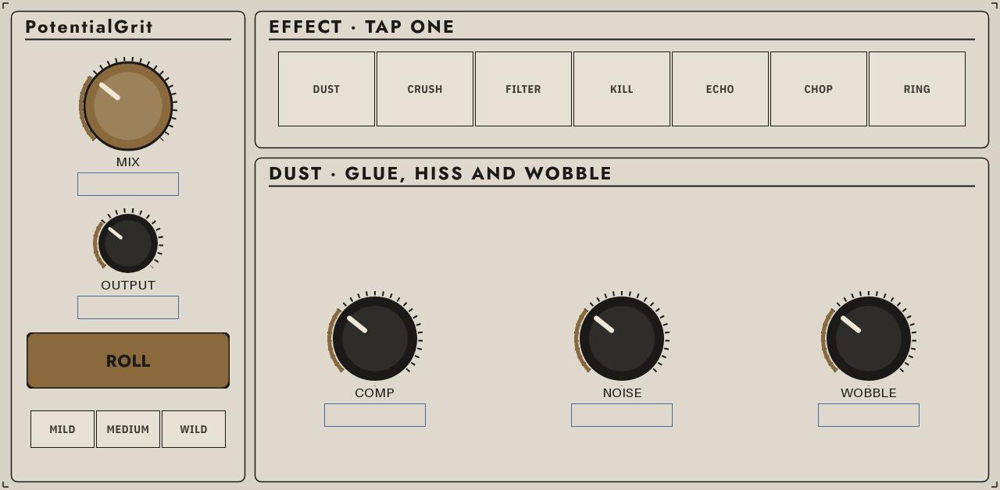
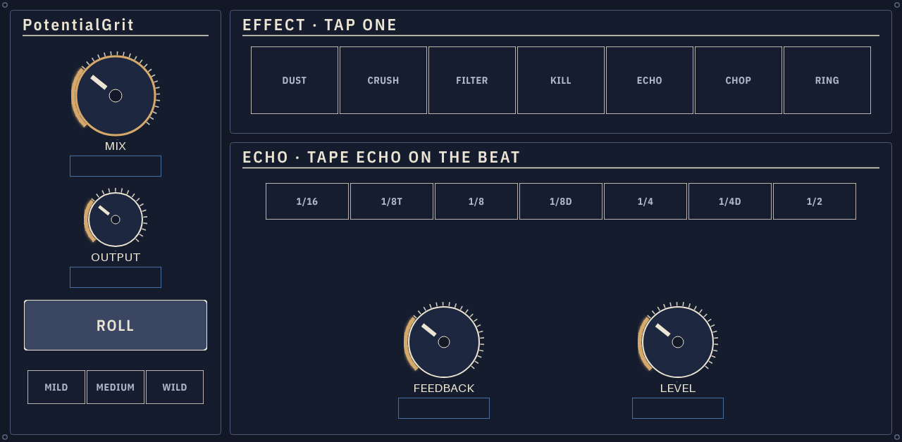

# PotentialGrit

**Seven lo-fi effects in one box, one tap to switch.** Dust, crush, filter, kill, echo, chop and ring: pick one from the pads, shape it with its own knobs, blend it with MIX.

*Insert effect · MPC OS 3.x · Gen1 and Gen2 · v1.2.0*

Free and open source (MIT), made by **PotentialBreaks**, part of the **PotentialSuite**, with the same four looks and LOOK switch as the rest of the suite. It runs inside the MPC as an insert effect, with its own touchscreen page, Q-Link control and project recall.

**[Download the latest release](../../releases/latest)** · [Ideas and bugs](../../issues/new/choose)

## The effects

Tap a pad to pick one. Each effect keeps its own settings, so you can flip between them and come back to where you were. Switching crossfades, so it won't click.

| Pad | What it does | Controls |
|---|---|---|
| **DUST** | Glue compression with soft saturation and a darker top, plus surface hiss, crackle and rumble, and wow-and-flutter wobble. The noise follows the music: it fades out when the track goes quiet. | COMP, NOISE, WOBBLE |
| **CRUSH** | Bit depth and sample-rate reduction like an early sampler, then a tone control to tame the fizz | BITS (2-16), RATE (1.5-44.1 kHz), TONE |
| **FILTER** | A resonant filter (LOW, BAND or HIGH PASS) into a saturator | CUTOFF, RESONANCE, DRIVE |
| **KILL** | A DJ-style three-band kill EQ: below 250 Hz, 250 Hz to 3 kHz, above 3 kHz. Turn a band all the way down for KILL. | LOW, MID, HIGH |
| **ECHO** | A dark, saturating tape echo locked to your tempo: 1/16, 1/8T, 1/8, 1/8D, 1/4, 1/4D or 1/2. The dry sound always passes through. | time pads, FEEDBACK, LEVEL |
| **CHOP** | A tempo gate that follows the song position while the MPC plays, with left/right bounce | rate pads (1/4 to 1/32, with triplets), DEPTH, PAN |
| **RING** | Ring modulation by a tone that an LFO can sweep two octaves each way | FREQ, SWEEP, SPEED |

Plus:
- **MIX** blends the original (0%) with the effect (100%).
- **OUTPUT** runs from -24 to +12 dB. Match levels with it before you judge.
- **ROLL** gives the effect that's on new settings. **MILD**, **MEDIUM** or **WILD** next to it sets how far it goes, and WILD sometimes picks another effect too.
- **Presets** in the MPC's PRESET menu: Dusty drum bus, Worn record, 12-bit grit, Broken, Next room, Telephone, Dub throw, Stutter, Ping-pong chop and Metal.
- **FX chains:** Dusty Loop, 90s Stab, Break Bus and Dub Drums. Pick the same name in PotentialPatina, PotentialPunch and PotentialBleed. See the [chains on the PotentialSuite page](https://github.com/PotentialBreakfast/potential-plugins#fx-chains).

**USER presets** (USER page): 8 slots of your own. Tap **SAVE**, then a slot, to keep the sound; tap a slot to bring it back. They're kept in `PotentialSuite Presets/PotentialGrit.txt` beside your VST2 Plugins folder, so every project sees them and updates keep them. The same slot number in each PotentialSuite effect makes a chain of your own.

**MANUAL page:** the manual is on the MPC's screen too. Tap **MANUAL**, then the page buttons along the top. The full [PotentialSuite manual](https://github.com/PotentialBreakfast/potential-plugins/blob/main/MANUAL.md) covers every plugin, the FX chains and a developer reference.

## Install

- **With MPC TOOLS:** in the Plugins tab, tap **UPDATE** on PotentialGrit.
- **With the Open MPC installer or Plugin Manager:** use `-mpc-armv7.zip` for a Gen1 (MPC One, Live, Live II, X, Key, Force) or `-mpc-aarch64.zip` for a Gen2.
- **By hand (MPC OS 3.10.1+):** unzip `-mpc-sdk.zip` and copy the folder `PotentialBreaks - VST - PotentialGrit` into `VST2 Plugins` at the top of a drive the MPC can see.

Then turn on **Preferences > Enhancements > VST2 Support**, restart the MPC, and add **PotentialGrit** as an insert effect.

## Credits and licence

MIT, see `LICENSE`. Inspired by DustBox from 6teen Levels and by the effects built into classic groove samplers. This is an independent design with its own code. Built with the [Open MPC kit](https://github.com/open-mpc/mpc-vst-plugins) (MIT). Not affiliated with or endorsed by Akai Professional or inMusic.
